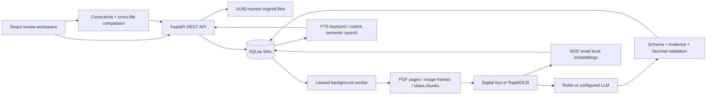
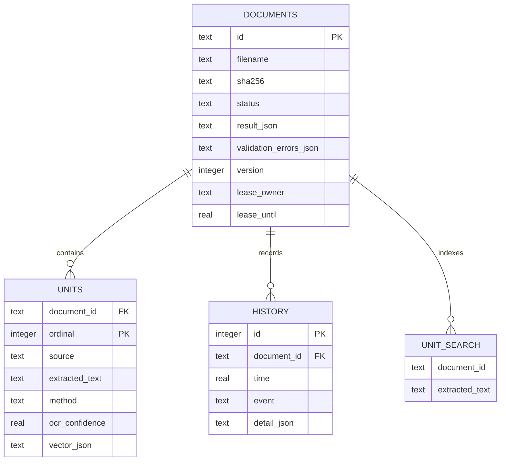

# Architecture

## State machine

`queued → processing → completed | review | failed`

Only failed jobs can be retried. Retry returns to queued and increases the record version. Claims use an immediate SQLite transaction, a random worker owner, and a 180-second lease. A heartbeat extends it every 30 seconds. Expired leases are requeued. Source units and search entries are replaced at the next attempt. Uploaded files are UUID-named; untrusted filenames are display metadata, never storage paths.

Corrections are allowed only for processed records. A submitted version must match the current version. The server retains original source references and evidence, sets method to manual, reruns validation, and stores before/after values plus the reason in history. Structural deletion of extracted invoices is deliberately disallowed by the simple correction endpoint.

## Tables

`schema.sql` is exported from the actual application schema. Invoice amounts serialize as decimal strings. Raw source text remains separate from corrected JSON. Keyword search covers source text and current structured results; semantic embeddings represent the source, not subsequent manual edits. Each vector represents the first 16,000 characters of a source unit, and the model tokenizer applies its context window. Consequently semantic retrieval may miss information near the end of long units; production work should use overlapping token-sized chunks.

## Why these alternatives

FastAPI replaces the suggested Node backend to avoid a second OCR service for this time-boxed exercise. SQLite substitutes for Postgres/Redis/vector infrastructure to keep setup reproducible and local. Atomic claims, persistent history, FTS5, and stored neural embeddings still demonstrate the required workflows. They do not establish multi-node scale or high availability. React with Vite supplies the requested frontend without requiring SSR.

## Security boundaries

Loopback is the default listening address. Optional bearer authentication applies to document and search routes. Cross-origin browser writes are denied; CORS is not enabled. React escapes document strings, CSP blocks inline scripts in the product interface, SQL parameters prevent query injection, and file downloads use attachment semantics. Upload extensions select a real parser; corrupt content fails in that parser. Per-file, pixel, page, row, column, decompression, and context guards bound common inputs.

These controls do not replace sandboxed parser processes, authenticated per-user authorization, ingress body/rate limits, malware scanning, encryption, retention policy, or production audit infrastructure. Native OCR has no hard process timeout in this baseline. A malicious file may still consume resources before a parser limit is reached. Run untrusted customer data only after adding the production controls described in the README.
